## 🧭 关于我

我是 **Yangxbao**,信息管理与信息系统专业大三在读。比起罗列"学过什么",我更在意"**做出了什么**":把课堂上和自学中学到的东西,陆续做成了 **十几个能跑、能测、能交付的开源项目** —— 从 AI 研发协作平台、RAG 知识库,到 Android 应用与 Windows 桌面工具。

目前的主线:**Java 后端** 打地基,**AI Agent 应用** 往前冲;开发中大量使用 AI 辅助编码,但每一行进仓库的代码都以"本人实际运行验证"为标准。

⚠️ 诚实说明(建议展开看一眼)

- 本页所有项目均为**真实公开仓库**,开发方式为 **AI 辅助编码 + 本人设计、运行与验证**;
- 各项目的完成情况与未验证边界(如 DevPilot 的 Docker Compose 路径、真实 LLM Provider 效果)都在各自 README 中**如实披露**,不做任何夸大;
- 页面中的统计数据由第三方服务实时生成,仅作活跃度参考,**不代表技术水平**。

## ⚡ 技术方向

### ☕ Java 后端 &nbsp;

- ✅ **已实践**(在开源项目中实际使用):Spring Boot 3 · MyBatis-Plus · Spring Security / JWT · MySQL 索引与 FULLTEXT · JUnit 集成测试 · GitHub Actions CI
- 🌱 **正在学习**:Redis 进阶 · 消息队列 · 分布式与微服务 · JVM 调优

### 🤖 AI Agent 应用 &nbsp;

- ✅ **已实践**(三个项目落地):RAG 全链路(解析 → 分块 → 索引 → 混合检索 → 证据引用)· Agent 工作流与工具白名单 · OpenAI 兼容 Provider 适配与降级
- 🌱 **正在学习**:向量数据库 · 多 Agent 协作 · 提示词工程

### 📱 移动端与前端 &nbsp;

- ✅ **已实践**:Kotlin + Jetpack Compose / Room / CameraX / ML Kit(**3 个 Android 应用,2 个发布 Release**)· Vue 3 + Element Plus + Pinia(4 个全栈项目前端)
- 🌱 **正在学习**:TypeScript 进阶 · 响应式布局

## 🚀 精选项目

### 🥇 DevPilot — 自托管 AI 研发协作平台

**让"读懂一个陌生代码库"变成可工程化的事**:代码库导入 → 关键词/语义混合检索 → **带证据引用的 AI 问答与 Bug 根因分析** → 缺陷任务闭环。

- 🔎 混合检索:MySQL FULLTEXT 关键词 + FTS5/向量语义,RRF 融合排序,结果带路径与行号
- 🤖 8 步 Agent 工作流:每条结论附**可点击核对的代码证据**,引用合法性自动核查
- 🐞 缺陷闭环:AI 分析一键转缺陷,状态机服务端校验,项目数据隔离
- 🧪 工程质量:20 JUnit + 31 pytest + 3 前端测试 + **18 步 E2E 全链路** + GitHub Actions CI

&nbsp; **→ [进入仓库](https://github.com/Yangxbao/DevPilot)**

<table>
  <tr>
    <td width="50%" valign="top">
      
      <h4><a href="https://github.com/Yangxbao/OfferDojo">🎓 OfferDojo</a></h4>
      面向大学生的岗位实战模拟平台:<b>220 个模拟任务 + 125 道八股</b>,AI 结构化评估报告,能力雷达。零配置即可一键启动(H2 内嵌库)。
       
      
      
    </td>
    <td width="50%" valign="top">
      
      <h4><a href="https://github.com/Yangxbao/repopilot-ai">🤖 repopilot-ai</a></h4>
      代码库知识问答与 Bug 分析 Agent:<b>先检索证据,再让 AI 回答</b>,引用精确到文件 + 行号;检索不到依据时如实回答"无法确定"。DevPilot 的前身。
       
      
      
    </td>
  </tr>
  <tr>
    <td width="50%" valign="top">
      
      <h4><a href="https://github.com/Yangxbao/docmind">📚 DocMind 智档</a></h4>
      完全本地的 RAG 文档知识库(检索层):MD / PDF / 截图穿透搜索,<b>相关度百分比 + 片段高亮</b>,自动打标签。数据不出本机,零 API 花费。
       
      
      
    </td>
    <td width="50%" valign="top">
      
      <h4><a href="https://github.com/Yangxbao/QRCode-Aggregate">📱 ScanAggregator 扫码聚合</a></h4>
      安卓本地扫码工具:<b>36 个应用快捷唤起</b>、平台识别规则引擎(改 JSON 不改代码)、二维码生成,全程<b>零网络权限</b>。
       
      
      
    </td>
  </tr>
</table>

### 🧰 更多项目

| 项目 | 一句话介绍 | 状态 |
|---|---|---|
| [**QuizMaster**](https://github.com/Yangxbao/QuizMaster) | 拍照 OCR 录题 + 离线刷题 Android App,题库全本地不联网 |  |
| [**grandma-home 奶奶的家**](https://github.com/Yangxbao/grandma-home) | 适老化 Android 桌面:大字界面 · 一键通话 · 家属 PIN 管理 |  |
| [**windows-file-map**](https://github.com/Yangxbao/windows-file-map) | 本机文件只读地图 + 白名单安全一键清理,纯 Python 标准库 |  |
| [**CleanSweep**](https://github.com/Yangxbao/CleanSweep) | Windows 彻底卸载助手:官方卸载 + 注册表/文件残留清理 |  |
| [**wecat-demo**](https://github.com/Yangxbao/wecat-demo) | HTML 小游戏合集:雷霆1942 · 大鱼吃小鱼 · 摸金突围 等 | [▶ 在线可玩](https://yangxbao.github.io/wecat-demo/) |
| [**FMSR 幻想地图模拟器**](https://github.com/Yangxbao/FMSR-FantasyMapSimulator) | Godot 4.2 重建战争模拟游戏(粉丝项目):战争 · 军队 · 外交 |  |
| [**DeadManSwitch 安全签到**](https://github.com/Yangxbao/DeadManSwitch-SafetyCheckin) | 微信小程序失联签到,超时自动邮件预警(学习 Demo) |  |

## 📊 GitHub 数据

<picture>
  <source media="(prefers-color-scheme: dark)" srcset="https://raw.githubusercontent.com/Yangxbao/Yangxbao/output/snake-dark.svg" />
  
</picture>

## 🗺️ 学习路线

当前进行中的事:**Redis / 消息队列补强** · **DevPilot P1**(异步任务队列、Git 历史分析)· **算法与八股** 为实习做准备。

## 📫 联系我

<!-- 📮 邮箱(取消注释并替换为你的邮箱)

-->

